<div align="center">

# The Support Desk

**One system for support and product: reviews become themes, questions become cited drafts, and the weekly fee explainer becomes the answer support reuses. A human approves every write.**

    

NextLeap Applied Generative AI Bootcamp · Cohort 7 · Capstone · Product: **Groww** with **HDFC Mutual Fund** schemes

**Live prototype:** _add your Render URL here_ &nbsp;·&nbsp; **Docs:** [`docs/`](docs/) &nbsp;·&nbsp; **Evals:** [`outputs/evals/`](outputs/evals/)

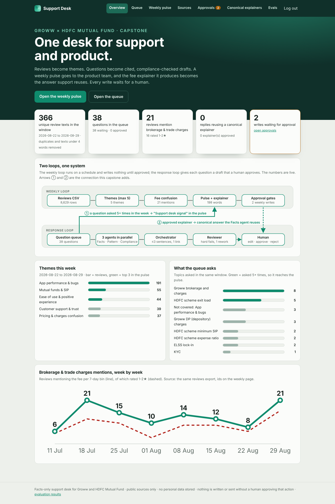

</div>

## Submission deliverables
| Portal field | Where |
|---|---|
| GitHub repository | this repo |
| Deployed application link | top of this README (add after the Render deploy) |
| 5 minute demo video | Google Drive link, access "Anyone with the link"; script in [docs/ui-guide.md](docs/ui-guide.md) |
| Evals report (golden dataset, adversarial tests, scores) | [EVALS_REPORT.md](EVALS_REPORT.md) |
| Source manifest (30+ official URLs) | [SOURCES.md](SOURCES.md) |

## Contents
[The problem](#the-problem) · [What it does](#what-it-does) · [The connection](#the-connection-between-the-loops) · [Architecture](#architecture) · [Screens](#screens) · [Quick start](#quick-start) · [MCP and the approval gate](#mcp-and-the-approval-gate) · [Scope enforcement](#scope-enforcement-in-code) · [Evaluation](#evaluation) · [The fee issue](#the-fee-issue-from-the-reviews) · [Samples](#samples) · [Documentation](#documentation) · [Repository layout](#repository-layout) · [Design decisions](#design-decisions) · [Known limits](#known-limits) · [Deploy](#deploy)

## The problem
Support answers the same fee question dozens of times a month, writing it fresh each time and sometimes getting it wrong. Product reads a dashboard that says "pricing confusion is up" without saying **which** fee or what support has been telling people. The missing data is in three places: what the official documents say, what users are confused about, and how often. This project puts all three behind one system.

## What it does
| | Weekly loop (product) | Response loop (support) |
|---|---|---|
| **In** | Reviews CSV, newest 7 days (366 usable reviews, 22–29 Aug 2026) | Queue of user questions |
| **Work** | ≤5 themes → top 3 → the recurring fee confusion | Three agents in parallel (Facts, Pattern, Compliance) → orchestrator → reviewer |
| **Out** | Pulse ≤250 words with quotes, counts, review ids and 3 actions; fee explainer ≤6 bullets with 2 official links and a last-checked date | Reply ≤3 sentences with one source link and last-checked date, plus an internal routing note |
| **Human** | Approves the doc append and the email draft **separately** | Approves, edits or rejects each draft |

Nothing is written or sent without a human approving that specific action. Email is created as an unsent draft.

## The connection between the loops
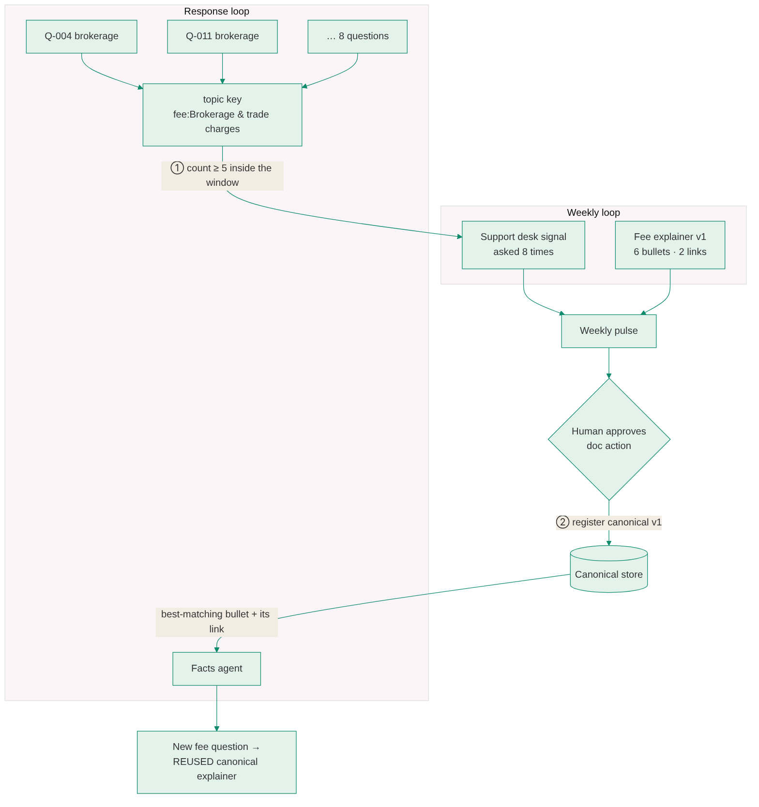

1. **Questions → pulse.** A topic asked **5 or more times** inside the weekly window appears in the pulse as a "Support desk signal" (in the shipped queue: *Groww brokerage and charges* ×8, *HDFC scheme exit load* ×5).
2. **Explainer → answers.** When a human approves the weekly doc entry, its fee explainer becomes the **canonical answer**. The Facts agent then answers matching fee questions with the best-fitting approved bullet and its link, and the routing note says *"REUSED canonical explainer … v1, not drafted fresh"*. The **Canonical explainers** page lists every ticket that reused it.

## Architecture
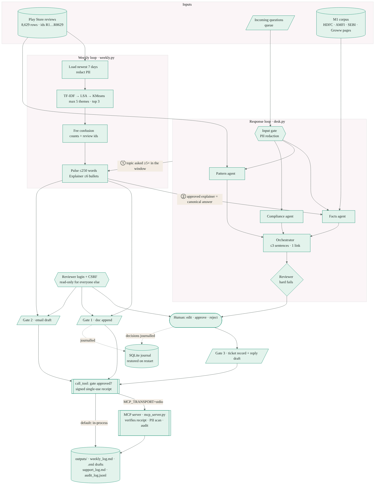

More diagrams (weekly sequence, response sequence, approval states) in [docs/architecture.md](docs/architecture.md).

## Screens
| | |
|---|---|
| 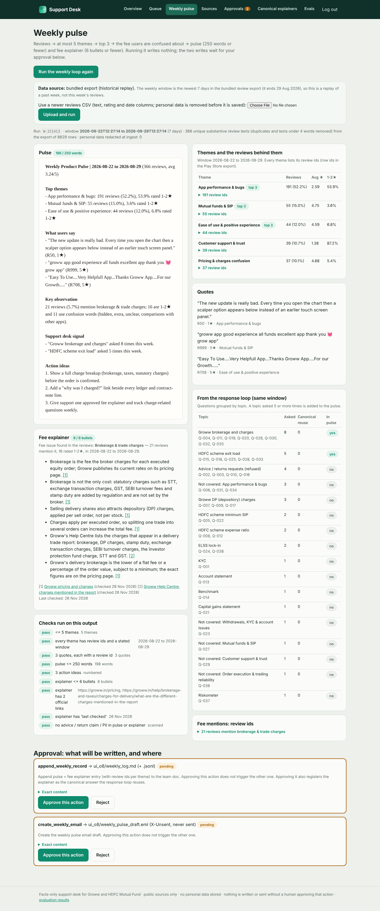 **Weekly pulse:** themes with expandable review ids, quotes, nine checks, two approval cards | 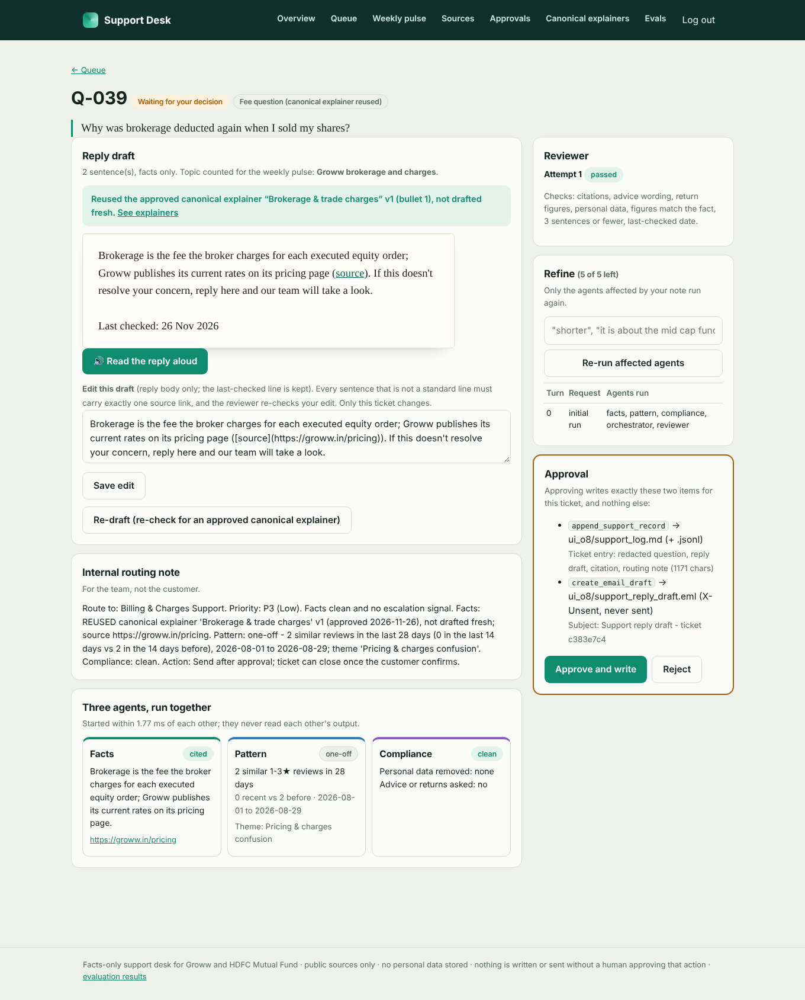 **Ticket:** canonical reuse, edit, reviewer, the two writes listed before approval |
| 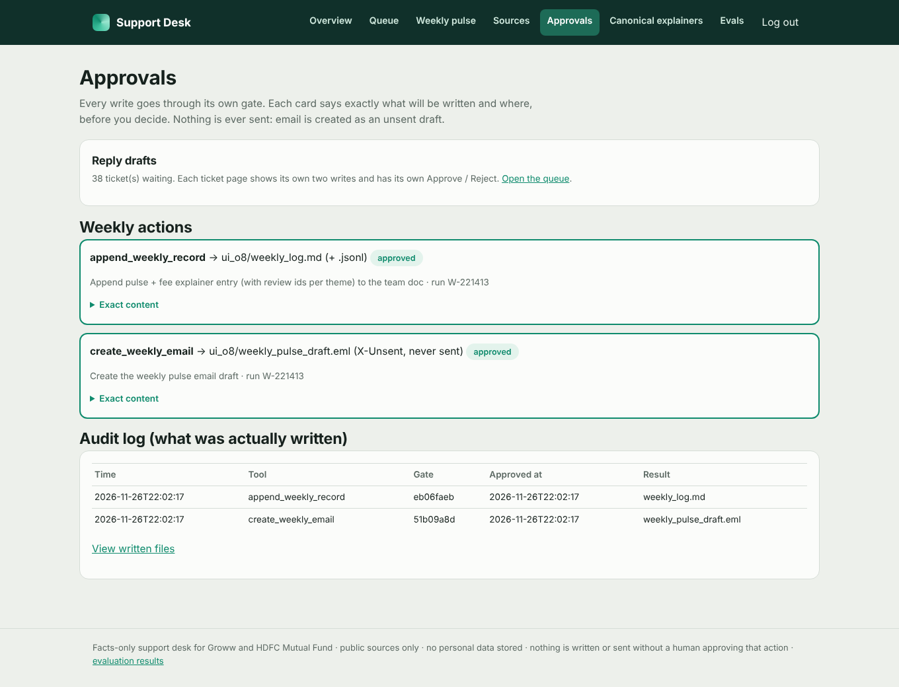 **Approvals:** exact content and audit log | 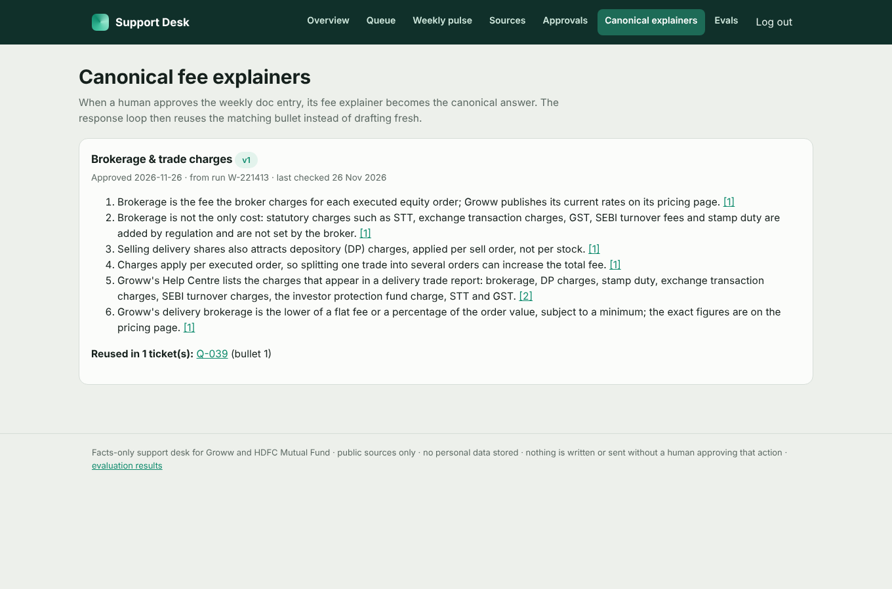 **Canonical explainers** and where they were reused |
| 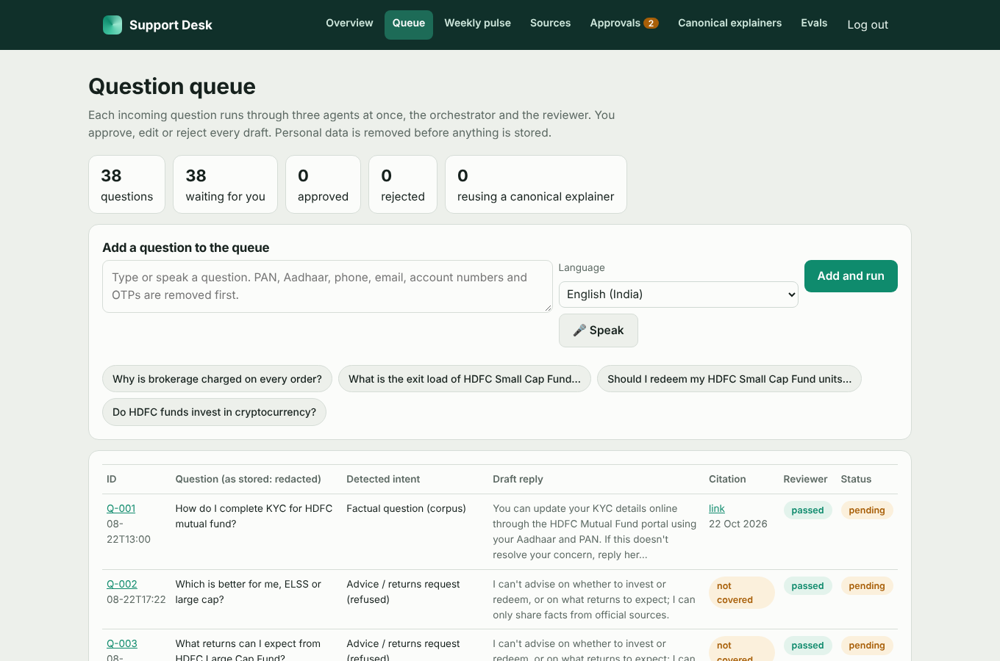 **Queue:** intent, draft, citation, reviewer flag | 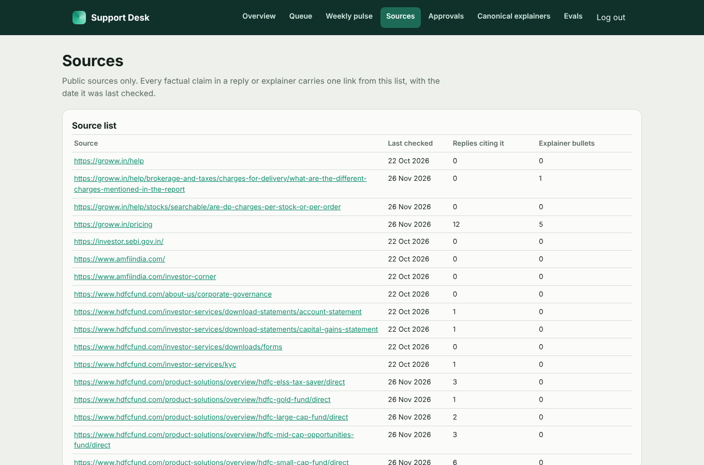 **Sources:** every link with its last-checked date |

| 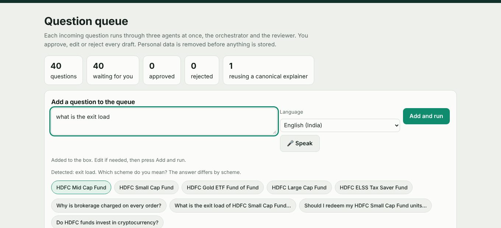 **Voice:** language, confirmation, intent preview, clarification chips | 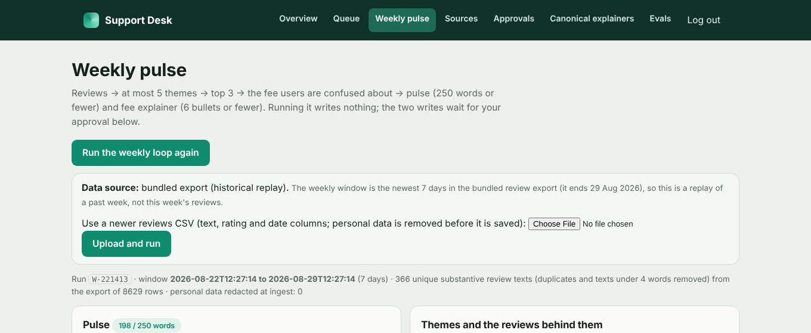 **Weekly data:** states it is a replay; upload a newer CSV |
| 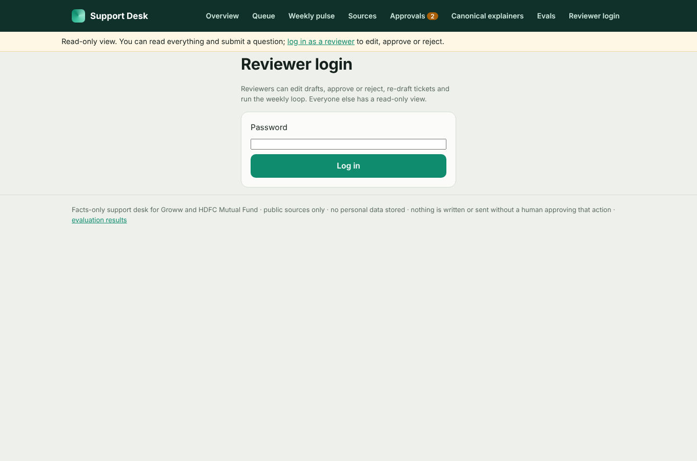 **Reviewer login:** the live desk is reviewer-only; everyone else sees the public sample demo (`/demo`) | |

Also: Overview (above), Evals, Written files. UI guide and a 3-minute demo script: [docs/ui-guide.md](docs/ui-guide.md).

## Quick start
```bash
pip install -r requirements.txt
python app.py                         # http://localhost:5000
python -m unittest discover -s tests -v
python -m evals.run_evals             # regenerates outputs/evals/*
python make_samples.py                # regenerates outputs/samples/*
python mcp_server.py                  # the MCP server (stdio); normally started by an MCP client
python tools/mcp_demo.py              # discovery + refused / allowed / replayed calls over the real protocol
python tools/scan_repo.py             # pre-submission scan for PII, secrets and stray generated files
REVIEWER_PASSWORD=choose-one python app.py   # the live desk needs it; without it only the public sample demo (/demo) is available
python make_demo.py                   # rebuilds data/demo_snapshot.json, the only data the public demo shows
python weekly_job.py                  # the scheduled, headless weekly run
docker compose up --build             # optional
```
No API key is needed: the agents are rules and retrieval. Environment variables are listed in [`.env.example`](.env.example).

**Try it (90 seconds):** Weekly pulse → read the pulse → expand *Exact content* → approve **only** the doc action → Queue → add *"Why was brokerage deducted again when I sold my shares?"* → see *REUSED canonical explainer* → Approvals shows the email action still pending.

## What was added after an independent review (26 Nov)
| Area | Now |
|---|---|
| Access | Reviewer login + CSRF + security headers. The live queue, tickets, weekly actions, approvals, audit log and written files are reviewer-only; every change, including adding a question, needs a reviewer. The public sees a read-only demo built from synthetic sample data (`make_demo.py` → `data/demo_snapshot.json`). No password set = live desk closed (fail closed) |
| MCP | A **real MCP server** (`mcp_server.py`, stdio) that refuses any write without a signed, single-use human-approval receipt |
| Persistence | SQLite journal replayed at start-up (approvals, refinements, re-drafts, edits, live questions, canonical explainers, uploaded reviews; text is stored redacted) |
| Weekly data | Upload a newer reviews CSV on the Weekly page, or `python weekly_job.py newer.csv`; the page says when it is a replay |
| Voice | Consent notice (the browser may send audio to Google or Microsoft), English / Hindi / Kannada and more, listening / processing / success / error states, transcript review before submission, retry and typed fallback, clarification chips, read-aloud. Tested with a **mocked** recogniser in a real browser engine; **not** tested with a live microphone |
| Facts | DP charges per sell order; five expense ratios and three source pages re-checked on 26 Nov |
| Reviewer | Also rejects sentences unsupported by the cited fact, including reworded or reordered ones |
| Evals | 169 checks in ten groups, including a 38-question hand-labelled golden dataset |

## MCP and the approval gate
`mcp_layer.py` defines four tools (served over the real protocol by `mcp_server.py`, see below), each with a name, description and input schema: `append_weekly_record`, `create_weekly_email`, `append_support_record`, `create_email_draft`. All writes go through `call_tool(name, args, gate)`, which refuses unless **that action's own** `ApprovalGate` is approved, then checks required arguments, re-scans the payload for PII, writes, and appends an audit line. Gates exist per action (two weekly, one per ticket); a draft the reviewer flagged cannot be approved (403). Full reference with schemas, sequence diagrams, failure modes and how to swap in real Docs/Gmail MCP servers: **[docs/mcp.md](docs/mcp.md)**.

**Real MCP server.** `python mcp_server.py` speaks the Model Context Protocol over stdio (default) or streamable HTTP (`--transport streamable-http`). Each write tool needs a `receipt_id`: a signed, single-use record issued only when a human approved that exact action, bound to the tool and a hash of the exact arguments. Missing, forged, replayed, wrong-tool and edited-after-approval receipts are refused (Eval 6, 10 checks). Receipts expire after 15 minutes and are single-use. Set `MCP_TRANSPORT=stdio` and the web app itself writes through this server as a child process in the same container. **Stdio suits a single container; outside MCP clients need the HTTP transport, which is a separate process that must share the output folder and `APPROVAL_SECRET`** (see [docs/mcp.md](docs/mcp.md#transport-architecture-and-what-a-hosted-deployment-needs)). The hosted demo uses the in-process default. The tool bodies still write local files and an unsent `.eml`; no Google Docs or Gmail connector is attached.

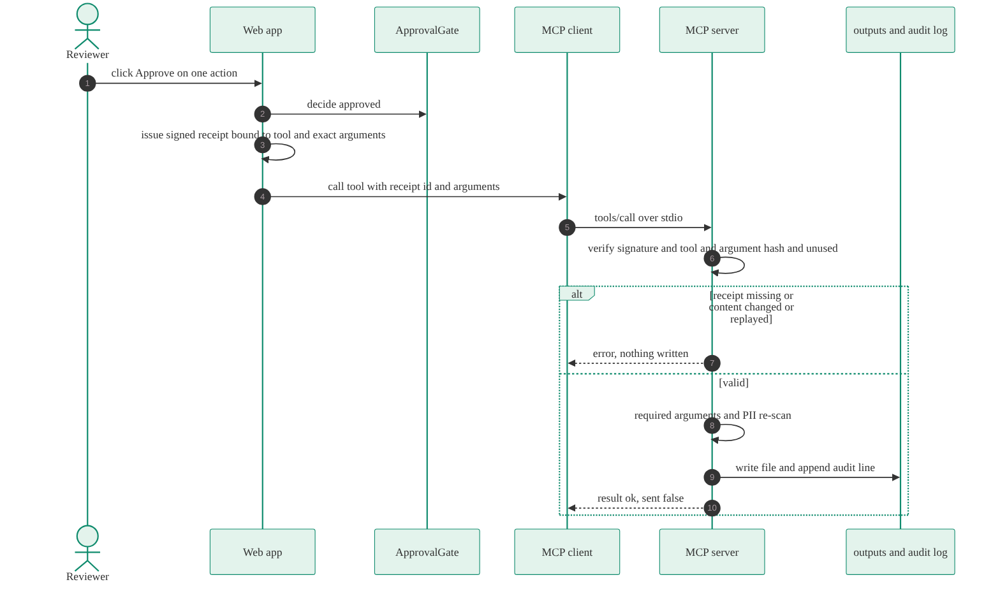

## Scope enforcement (in code)
| Rule | Enforced by |
|---|---|
| Facts-only; no advice, buy/sell, return or performance figures | Refusal template chosen by `ComplianceAgent`; reviewer hard-fails on advice language, return claims and figures not in the fact; weekly quotes pass `clean_ok`; human edits are re-reviewed |
| One source link per claim, from the M1 corpus | Reviewer: each non-standard sentence needs exactly one allowed link equal to the retrieved fact's; explainer bullets carry [1]/[2] markers |
| Corpus can't answer → say so and name what was searched | `validate_output` rejects a not-covered result without a `searched` list |
| No PII in data, UI, logs or agent state | `pii.redact` is the first line of `Desk.submit` and of weekly ingest; logs hold ids, hashes and codes; payload re-scan in `call_tool` |
| Every theme traces to review ids; every count states its window | Theme rows carry `review_ids` and `window` |
| Nothing written without approving that action | Per-action gates |

Rule-by-rule map and threat model: [docs/compliance-model.md](docs/compliance-model.md).

## Evaluation
`python -m evals.run_evals` runs ten groups of checks over the assembled system (about 30 s, no network except the local MCP subprocess). Results are saved in [`outputs/evals/`](outputs/evals/) and shown on the Evals page.

| Eval | Result | What it proves |
|---|---|---|
| **Feasibility** | 13/13 | All 38 queued questions get a draft or explicit "not covered"; weekly loop completes unattended in a separate process; caps held; both connections work |
| **Correctness of edits** | 16/16 | State is diffed before and after: an edit changes only its draft; rejecting leaves the queue untouched; approving one action never triggers another; flagged drafts and pending gates cannot write |
| **Grounding and compliance** | 26/26 | 15 sampled claims trace to a link or review id; 8 unanswerable questions say so; 32 advice/return attempts and 14 PII messages (rephrased, repeated) refused or redacted; a poisoned reviews file leaves the pulse clean; no log or file holds sensitive values |

| **Regressions** (from outside reviews, 26 Nov) | 17/17 | DP charges are per sell order; fabricated and meaning-flipped claims that keep a valid source link are rejected; CSV upload is cleaned and moves the window; poisoned reviews never reach the Pattern Agent index; IFSC and UPI redacted; five expense ratios match the HDFC pages checked 26 Nov; generic "charges" no longer counted as brokerage |
| **Golden dataset** (hand labels in `data/golden.csv`) | 39/39 | status and cited page for all 38 questions, plus a summary row |
| **MCP server** (stdio and streamable HTTP) | 13/13 | discovery, refusals without a valid receipt, tampered or replayed receipt, validation failure, PII, audit, app routed through the server |
| **Persistence** | 5/5 | a restart keeps approvals, live questions and the canonical explainer; replay writes nothing |
| **Approval security** | 12/12 | rejection, duplicate and 12-way concurrent approvals, receipt expiry and 8-way replay race, edit isolation, database diffed before and after |
| **Privacy across pathways** | 10/10 | submit, refine, edit, preview API, CSV upload, Pattern Agent cache and vocabulary, SQLite, logs, browser storage, no audio route |
| **Assignment requirements** | 18/18 | weekly loop, response loop, connection and compliance asserted one by one |

The evals found real bugs, including a persistence assertion that had been written too loosely (a restore run twice created duplicate tickets while the test still passed; the code is now idempotent and the assertion exact). Two earlier ones: (return-figure questions answered "not covered" instead of refused; fee questions counted as brokerage but missing the canonical answer). Both were fixed in code. Methodology and limits: [docs/evaluation.md](docs/evaluation.md).

## The fee issue from the reviews
**Brokerage and trade charges.** In 2026-08-22 to 2026-08-29, **21 of 366** unique substantive review texts (5.7%) mention it, **16 rated 1–2★**, 11 using confusion wording (hidden, extra, unclear, comparisons with other apps). The weekly count is level with the 18 Jul week (21 each) and above the other six bins (range 6–21). **How the 366 arises:** the export has 1,067 review records in the 7-day window, 630 distinct texts, and 366 after dropping texts under four words (so "Best", "Excellent" and repeats are not counted). The fee match uses explicit fee wording (brokerage, per order, hidden or extra charge and similar); an earlier version matched any use of the word "charges" and counted 41, which an outside review showed was too broad. Review ids are on the Weekly page.

## Samples
[`outputs/samples/sample_outputs.md`](outputs/samples/sample_outputs.md): five sample questions with drafts and routing notes (canonical reuse, scheme fact, not covered, advice refused, PAN redacted), the appended weekly doc entry, the weekly email draft, a support record and a reply draft. Reviews: [`data/reviews_sample.csv`](data/reviews_sample.csv) (40 rows) and the full redacted [`data/reviews.csv`](data/reviews.csv).

## Documentation
| Document | Contents |
|---|---|
| [problem-statement.md](docs/problem-statement.md) | The brief and a 28-row requirement → code → evidence table |
| [architecture.md](docs/architecture.md) | Components, sequences, state machine, trust boundaries, trade-offs |
| [mcp.md](docs/mcp.md) | Tool catalogue, schemas, gate protocol, audit log, failure modes, going live |
| [implementation-plan.md](docs/implementation-plan.md) | Stack, phases, decisions that changed |
| [deployment-plan.md](docs/deployment-plan.md) | Render, Docker, CI, scheduling, env vars, checklist |
| [evaluation.md](docs/evaluation.md) | What each eval checks, results, what they found, limits |
| [edge-cases.md](docs/edge-cases.md) | Cases with status: tested, checked or limit |
| [compliance-model.md](docs/compliance-model.md) | Threat model, rule → code map, what is not claimed |
| [data-dictionary.md](docs/data-dictionary.md) | CSV schemas, run and ticket objects |
| [ui-guide.md](docs/ui-guide.md) | Screens, demo script, design notes |
| [milestone-lineage.md](docs/milestone-lineage.md) | What came from Milestones 1–3 and what is new |
| [SOURCES.md](SOURCES.md) | Source manifest: every official URL and its use |
| [EVALS_REPORT.md](EVALS_REPORT.md) | Golden dataset, adversarial tests and scores in one file |

## Repository layout
```
app.py  service.py            Flask routes · both loops, gates, canonical store, snapshot/diff
weekly.py  pipeline.py        weekly loop · clustering, fee issue (from Milestone 2)
desk.py  agents.py            response loop · Facts / Pattern / Compliance (from Milestone 3)
orchestrator.py reviewer.py   reply + routing note · hard-fail review
corpus.py corpus_registry.py  Milestone 1 corpus and retrieval
mcp_layer.py                  four MCP-style tools behind ApprovalGate
pii.py                        redaction
weekly_job.py                 headless weekly run (cron / Actions / n8n)
evals/run_evals.py  tests/    three evaluations · unit tests
make_samples.py scripts_prepare.py
data/                         reviews.csv · reviews_sample.csv · questions.csv · source_checks.json
templates/ static/            UI
docs/                         documentation, diagrams (docs/diagrams/*.mmd), screenshots
outputs/evals  outputs/samples   saved evidence
Dockerfile docker-compose.yml render.yaml Procfile n8n-workflow.json .github/workflows/
```

## Design decisions
- **Three sources, one answer.** Official pages say what is true, reviews say what confuses people, the queue says how often. A fee answer cites the page, is counted in the pulse, and is checked against the review trend (a rising trend puts the ticket on HOLD).
- **Where the model stops being reliable, the system says so.** Nothing factual is generated: replies are templates around one retrieved sentence. When retrieval has nothing it says so and lists what it searched. The optional LLM may only rephrase and is re-reviewed.
- **A gate a compliance team could trust.** One gate per write, exact content shown before the click, no path around `call_tool`, server-side refusal for flagged drafts, re-reviewed edits, audit log.
- **Intent handling.** Each queue row shows a detected intent (factual, fee with canonical reuse, advice refused, not covered) and PII-removed flags. The brief lists no voice feature, so voice is an optional mic button on the question box.

## Known limits
- **The 38 queued questions are written for this demo (no real customer data).** "Asked 8 times" describes that set, not real traffic. The demo clock is pinned to the end of the reviews export (29 Aug 2026) so questions and reviews share one week. After a reviews upload the clock moves to the new data, so the seeded August questions no longer fall in the window.
- **"Same question" means same topic key** (rule-based), not semantic clustering.
- **Sources.** Checked on 26 Nov 2026: the five HDFC scheme pages, `groww.in/pricing` and two Groww Help Centre pages. The HDFC pages show no as-of date for the expense ratio, so it is current only on the check date. Not re-opened: `groww.in/help` (home), SEBI, AMFI and the HDFC service pages. The corpus still lists some older HDFC addresses as supporting references. See [SOURCES.md](SOURCES.md).
- **Reviews:** 8 weeks only; clusters are unsupervised and noisy, named by a lexicon. The pulse shows the top 3 by volume, so the small, very negative *Customer support & trust* theme (39 reviews, 87% rated 1–2★) is on the Weekly page but not in the pulse's top 3. One quote (R999) is a generic positive review. "366 reviews" means unique substantive texts (1,067 records in the window, 630 distinct, 366 with four or more words).
- **The weekly loop replays the bundled export** unless a newer CSV is uploaded. The scheduled GitHub Action therefore repeats the same window until a newer file is committed or uploaded.
- **The reviewer checks support by words and word order, not by meaning.** A sentence that preserves the fact's phrasing but is wrong for another reason is outside what it can see. Human edits get the same check and a harmless rewording may be refused.
- **Access:** one shared reviewer password; no per-user accounts or per-approver audit. Questions can only be added by a logged-in reviewer (customers do not submit directly).
- **Persistence works only on a persistent disk** (Docker volume, Render paid disk). On Render's free tier the filesystem is ephemeral, so a redeploy starts fresh.
- **MCP:** a real server and a real protocol, but the tool bodies write local files and an unsent `.eml`; no Google Docs or Gmail connector is attached.
- **The default build is deterministic** (retrieval, rules, templates). The optional Groq path is off unless a key is set and is untested.
- **Advice detection is regex-based** and can be bypassed by unusual phrasing; the reply would still be a cited fact or "not covered".
- **Voice:** the automated tests use a mocked recogniser (7 browser tests). No live microphone test has been done by the author; do the manual check in [docs/ui-guide.md](docs/ui-guide.md). Browser speech recognition may send audio to the browser vendor's cloud; this app never receives or stores audio, and shows a consent notice first.
- **A ticket approval authorises two writes** (the support-log record and the reply draft) because they are one decision about one ticket; the weekly doc append and email draft are separate decisions. Both are shown before the click.
- **The HTTP MCP transport has no login of its own;** keep it on localhost or behind an authenticating proxy.
- **A fresh-environment install and the `gunicorn` start command could not be run in the authoring sandbox** (no package index access); versions installed locally satisfy `requirements.txt`. **The Docker image and the n8n workflow were not built or run** in the authoring sandbox.
- More in [docs/edge-cases.md](docs/edge-cases.md).

## Deploy
1. Push this folder to a **new** GitHub repo (keeps Milestone 3 as submitted).
2. Render → New → Web Service → select the repo (`render.yaml` sets build and start: `gunicorn app:app --workers 1 --threads 4`).
3. Read the generated `REVIEWER_PASSWORD` in Render → Environment. Open the URL, check `/healthz`, log in as reviewer, click through Overview → Weekly pulse. Put the URL at the top of this README.
4. Optional schedule: the `weekly-loop` GitHub Action runs `weekly_job.py` every Monday 09:00 IST; add secrets `APP_URL` and `WEEKLY_TOKEN` (same value as the Render variable) to also trigger the hosted app. `n8n-workflow.json` is an optional alternative.

Details and checklist: [docs/deployment-plan.md](docs/deployment-plan.md).

---
MIT licence · Built for the NextLeap Applied Generative AI Bootcamp, Cohort 7.
