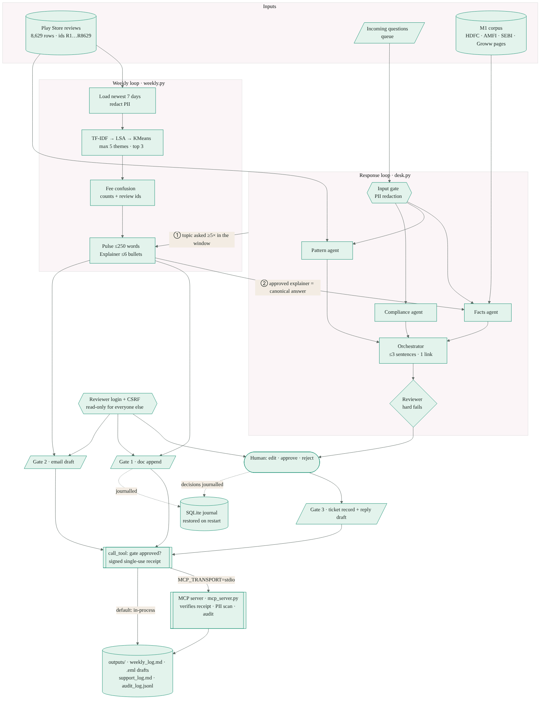
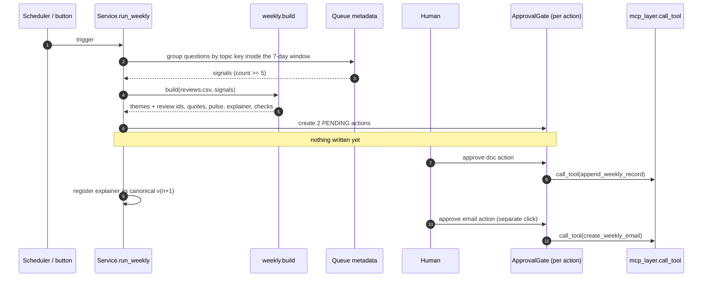
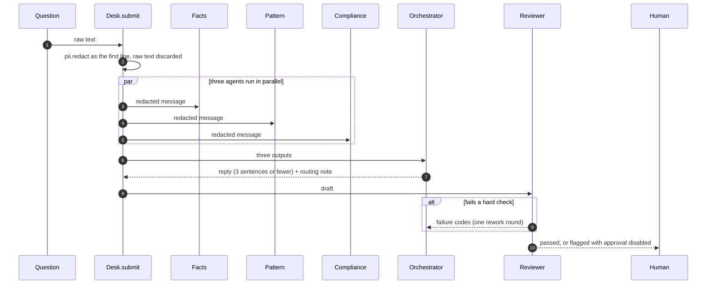
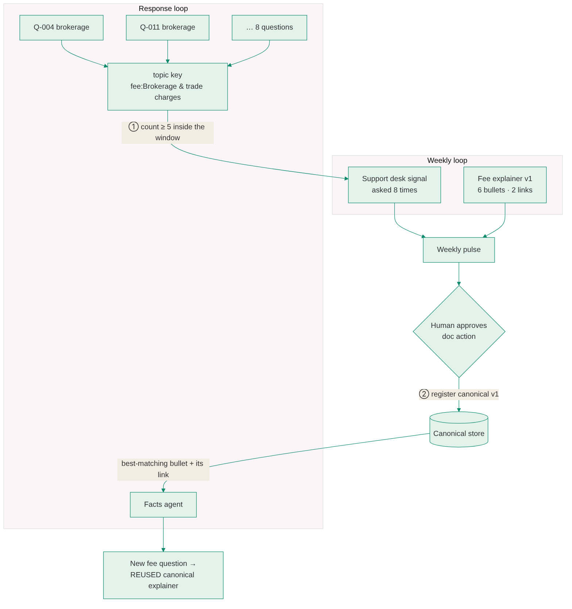
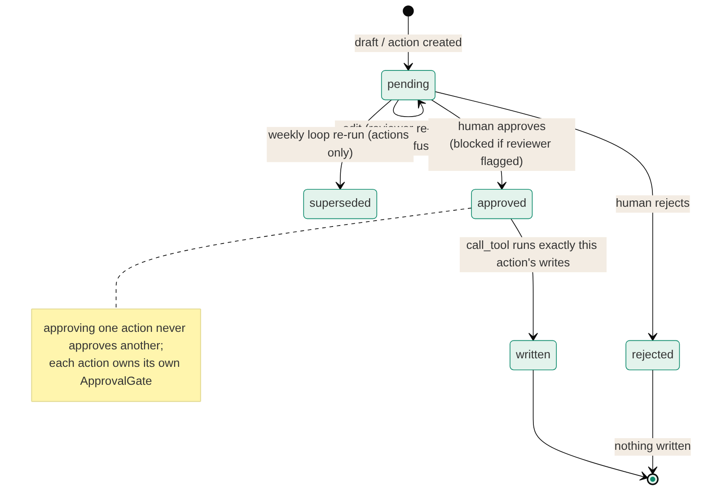

# Architecture

Source diagrams are Mermaid files in [`diagrams/`](diagrams/) (rendered PNGs in `img/`). GitHub also renders the Mermaid blocks below.

## 1. Components

| Layer | Module | Responsibility |
|---|---|---|
| UI | `app.py`, `templates/`, `static/style.css` | Flask routes; thin: every state change calls `Service` |
| Orchestration of both loops | `service.py` | Queue, topic keys, weekly run, per-action gates, canonical store, `snapshot()`/`diff()` |
| Weekly loop | `weekly.py`, `pipeline.py` | Load window, redact, cluster, fee issue, pulse, explainer, checks |
| Response loop | `desk.py`, `agents.py`, `orchestrator.py`, `reviewer.py` | Input gate, 3 parallel agents, draft, review/rework, refinement router |
| Knowledge | `corpus.py`, `corpus_registry.py` | 74 sentence-level facts from 16 public pages; TF-IDF + intent/scheme retrieval; `ALLOWED_URLS` |
| Safety | `pii.py`, `ComplianceAgent`, `reviewer.py` | Redaction; advice/return detection; hard-fail review |
| Tools | `mcp_layer.py` | Four MCP-style tools behind `ApprovalGate` ([mcp.md](mcp.md)) |
| Scheduling | `weekly_job.py`, `.github/workflows/weekly.yml`, `n8n-workflow.json` | Headless weekly run |
| Evidence | `evals/run_evals.py`, `make_samples.py`, `tests/` | Evaluations, samples, unit tests |

## 2. Weekly loop

**Steps inside `weekly.build`:** load the newest 7 days (`pipeline.load_reviews`, drops reviews under 4 words and duplicates) → redact again (defence in depth, counts what it found) → TF-IDF → LSA → KMeans, k ≤ 5, clusters named by lexicon lift (Hungarian matching) → top 3 by volume → one quote per top theme, filtered by `clean_ok` (no advice, return claim or PII) → fee issue by counting fee-type regexes → pulse text, trimmed until ≤250 words → explainer from the fee knowledge base with per-bullet source markers → nine output checks.

## 3. Response loop

- The three agents start behind a `threading.Barrier`, receive only the redacted message and never read each other's output. The ticket page shows start spread and per-agent timing.
- **Facts** returns one sentence with one URL, or `not_covered` plus what it searched. It checks the canonical store first (fee questions with no scheme named).
- **Pattern** matches the message to review themes and counts similar 1–3★ reviews in a 28-day window (14/14 split) to label it one-off, recurring or rising.
- **Compliance** removes nothing itself (the gate already did); it records PII types, flags advice/return requests, and later scans the outgoing draft.
- **Orchestrator** builds the reply from fixed templates around the single retrieved sentence, so it cannot add claims. Routing: team, priority (rising P1, recurring P2, one-off P3) and a **HOLD** when Facts is clean but Pattern is rising.
- **Reviewer** hard fails: uncited claim, wrong/foreign citation, advice language, return claim, surviving PII, a figure not in the fact, >3 sentences, missing last-checked date. One rework round, then the draft is flagged and **Approve is disabled** (server-side 403).

## 4. The connection

1. **Signal up.** `Service.topic_of` assigns each ticket a key (`fee:<type>`, `faq:<intent>`, `advice`, `other:<theme>`). `question_groups` counts keys inside the weekly window; keys with count ≥ 5 (excluding advice and not-covered themes) are passed into `weekly.build` and printed in the pulse's "Support desk signal".
2. **Canonical down.** Approving the weekly doc action calls `_register_canonical`, storing the explainer (versioned). `FactsAgent` then answers a matching fee question with the best-overlapping bullet and *its* link, and the routing note records "REUSED canonical explainer … v1". Earlier tickets keep their drafts until a human clicks Re-draft.

## 5. Approval state machine

Every action (two weekly, one per ticket) owns an `ApprovalGate`. `call_tool` refuses unless **that** gate is `approved`.

## 6. Trust boundaries and data handling

| Boundary | What crosses | Control |
|---|---|---|
| User → system | Free text (may contain PII) | `pii.redact` as the first statement of `Desk.submit`; the raw string is deleted |
| Reviews export → weekly loop | Public review text | Redacted at preparation and again at ingest; quotes filtered |
| Agents → each other | Nothing | Parallel threads; only the redacted message is shared input |
| Draft → human | Text + routing note | Reviewer hard fails; flagged drafts cannot be approved |
| Human → disk | Approved payload only | `call_tool` re-scans for PII; writes only after the action's own gate is approved |
| Logs | ids, hashes, codes, counts | `log_event` never receives message text |

## 7. State and concurrency
All state is in memory in one `Service` object (single gunicorn worker, `RLock` around mutations). Written artefacts are plain files under `outputs/`. A restart resets the queue and canonical store (documented limit). `Service.snapshot()` produces a deterministic view used by the edit-correctness eval to diff state before and after each action.

## 8. Key decisions and trade-offs

| Decision | Why | Cost |
|---|---|---|
| Replies are templates around one retrieved sentence | A reply cannot contain a claim that is not in the corpus | Less fluent; optional LLM may rephrase but is re-reviewed |
| Rules + TF-IDF instead of an LLM and vector DB | Reproducible, offline, no keys, no PII leaving the process | Weaker on unusual phrasing; regex advice detection can be bypassed |
| Per-action gates, not one global approve | The brief: "approving one action doesn't trigger another" | More clicks |
| Canonical reuse only after human approval | An unapproved explainer must not become the answer | Reuse starts after the first approval |
| Topic key as "same question" | Deterministic and explainable | Not semantic clustering |
| Local-file MCP | Safe and testable; gate semantics identical to a live server | Not connected to real Docs/Gmail |
