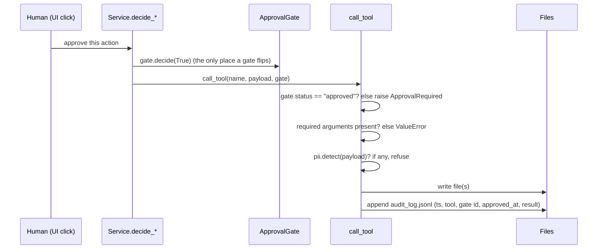
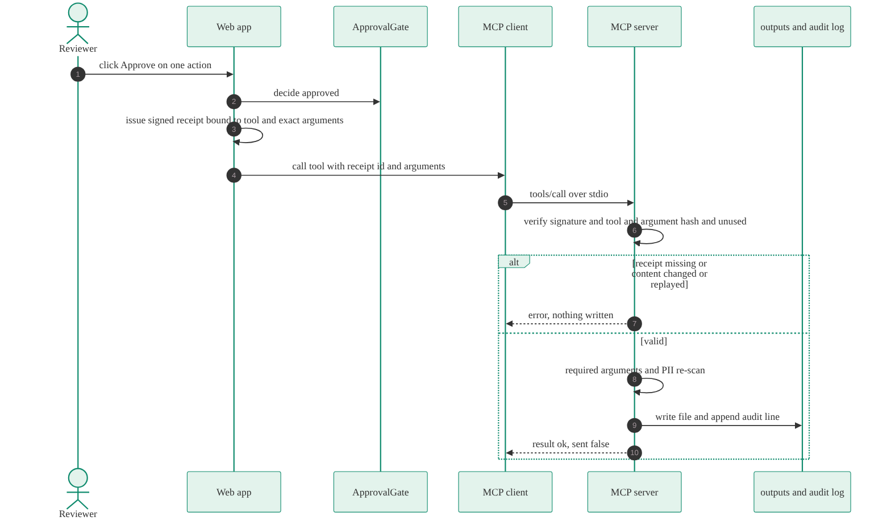

# MCP layer and approval gate

`mcp_layer.py` exposes the system's writes as **MCP-style tools**: each has a name, a description and a JSON input schema (`list_tools()`), and each is invoked through one function, `call_tool(name, arguments, gate)`. In the tool-use sense this is the "act" half of the system: agents and the weekly loop only *prepare* payloads; nothing touches disk or email except through a tool call that a human has approved.

> The tools are implemented locally (files, and unsent `.eml` drafts), as allowed by the brief and as in Milestones 2 and 3. To go live, replace the bodies of the four `_impl` functions with calls to a Google Docs MCP server and a Gmail MCP server; the gate, schemas and audit log do not change.

## Tool catalogue

| Tool | Used by | Writes to | Required arguments |
|---|---|---|---|
| `append_weekly_record` | Weekly doc action | `weekly_log.md` + `weekly_log.jsonl` | `run_id`, `window`, `entry_md`, `pulse`, `explainer` |
| `create_weekly_email` | Weekly email action | `weekly_pulse_draft.eml` + `.txt` (header `X-Unsent: 1`) | `subject`, `body` (`to` left blank) |
| `append_support_record` | Ticket approval | `support_log.md` + `support_log.jsonl` | `ticket_id`, `date`, `complaint_redacted`, `reply_draft`, `citation_url`, `last_checked`, `routing_note`, `priority`, `ticket_status`, `agents_fired` |
| `create_email_draft` | Ticket approval | `support_reply_draft.eml` + `.txt` | `subject`, `body` |

None of the tools sends anything. Email tools create a draft with `X-Unsent: 1` and an empty `To` header (customer contact details are never stored).

### Example schema (as returned by `list_tools()`)
```json
{
  "name": "append_weekly_record",
  "description": "Append the approved weekly pulse + fee explainer entry to the team doc (outputs/weekly_log.md).",
  "inputSchema": {"type": "object", "required": ["run_id", "window", "entry_md", "pulse", "explainer"]}
}
```

## The gate protocol



1. **A gate is created `pending` and only `Service.decide_ticket` / `decide_action` flips it**, from a human POST.
2. **Gates are per action.** Two weekly actions and one gate per ticket; approving one never touches another (tested in `edit_correctness.md`).
3. **`call_tool` checks, in order:** gate approved → required arguments → PII re-scan of the JSON payload → implementation → audit line.
4. **A flagged draft cannot reach `decide_ticket(approve=True)`** (returns 403) because the reviewer set `send_blocked`.
5. **Superseded actions.** Re-running the weekly loop marks a *different* run's pending actions `superseded`; they can no longer be approved. Re-running *identical* content never reopens an approved action (that would duplicate the write); a rejected action is re-offered under a new id.
6. **Failed writes.** A decision becomes `approved` only after its writes succeed; if a write fails the gate returns to pending and nothing is journalled.

## Audit log
`audit_log.jsonl`, one line per executed tool call:
```json
{"ts": "2026-11-26T21:05:12", "tool": "append_weekly_record", "gate": "9c1f0a2e", "approved_at": "2026-11-26T21:05:12", "result": {"ok": true, "path": "weekly_log.md", "chars_appended": 2517}}
```
It holds no message text. The Approvals page shows its last 15 lines.

## What a human sees before approving
- **Weekly:** each action card shows the tool, destination, one-line purpose and an expandable **Exact content** block (the literal entry that will be appended, or the literal subject and body of the draft).
- **Ticket:** the Approval card lists the two writes, their destinations and the email subject before the button.

## Payload examples
Real outputs are in [`outputs/samples/sample_outputs.md`](../outputs/samples/sample_outputs.md): the appended weekly doc entry (pulse, explainer, review ids per theme), the weekly email draft, a support record and a reply draft.

## Failure modes and how they are handled
| Situation | Behaviour |
|---|---|
| Tool called with a pending or rejected gate | `ApprovalRequired`; nothing written (eval: "MCP layer refuses any tool call while the gate is pending") |
| Missing argument | `ValueError`; nothing written |
| PII survives into a payload | `ValueError("payload still contains PII …")`; nothing written |
| Action decided twice | Second call returns "already approved/rejected"; state unchanged |
| Disk write fails | Exception surfaces; the gate is already `approved`, so the audit line is absent; re-approval is not offered (known limit) |

## Replacing the local tools with real MCP servers
1. Keep `TOOLS` (names + schemas).
2. In `_append_weekly_record`, call the Docs server's append tool with `entry_md`; in `_create_weekly_email`, the Gmail server's *create draft* tool (never *send*).
3. Keep `call_tool` unchanged so the gate, PII re-scan and audit trail still wrap the external call.


## A real MCP server (added 26 Nov 2026)
`mcp_server.py` is a genuine Model Context Protocol server (stdio, built with the official `mcp` Python SDK, `pip install -r requirements.txt`). It exposes the four write tools and enforces the approval gate **at the protocol boundary**:



- **Receipts.** When a human approves an action, the web app issues a signed, single-use receipt bound to the tool name and a SHA-256 of the exact arguments (`mcp_layer.issue_receipt`; key from `APPROVAL_SECRET` or a generated file).
- **Verification.** Every tool call must carry `receipt_id`. The server refuses when the receipt is missing, forged, for a different tool, for different arguments (content edited after approval), or already used. It then re-checks required arguments and PII, writes, and appends an audit line marked `"via": "mcp-server"`.
- **Two ways to run.** Default: the web app calls the tool bodies in-process (no extra dependency). With `MCP_TRANSPORT=stdio` the app routes every approved write through the MCP server as a client. Any other MCP client (Claude Desktop, an agent framework) can connect with `python mcp_server.py`, but without a receipt it can write nothing.
- **Tested** by Eval 6 (10 checks): tool listing over the protocol, no receipt, tampered arguments, wrong tool, valid write, replay, PII with a valid receipt, audit line, and the app's own approval routed through the server.
- **What is still simulated:** the tool bodies write local files and an unsent `.eml`. No Google Docs or Gmail connector is attached; swapping the bodies for those servers changes only `mcp_layer._IMPL`.


## Transport architecture and what a hosted deployment needs
| Mode | How | Needs | Use it for |
|---|---|---|---|
| **In-process (default)** | the web app calls the tool bodies directly after the gate approves | nothing extra | Render free tier, local demo |
| **stdio child process** | `MCP_TRANSPORT=stdio`: the web app starts `mcp_server.py` as a child process of the same container for each approved write, and talks MCP over its stdin/stdout | the `mcp` package (now in `requirements.txt`); same container, same filesystem | proves every approved write crosses a real MCP boundary, also on a single hosted service |
| **streamable HTTP** | `python mcp_server.py --transport streamable-http --host 127.0.0.1 --port 8765` | a running process; the **same output folder and `APPROVAL_SECRET`** as the web app so it can verify receipts; network access control (the server has no transport-level login: bind to localhost or put it behind an authenticating proxy) | MCP clients that are not the web app (Claude Desktop with a remote connector, an agent framework) on the same host or a private network |

Stdio is **not** a hosted-service transport for outside clients: it only works when the client launches the server itself. Remote clients need the HTTP transport, which is a separate process that must share storage with the web app. On a platform that gives each service its own filesystem (a second Render service), receipts written by the web app would not be visible to the server, so run both processes in one container or on one VM with a shared disk. The in-process default avoids that problem and is what the hosted demo should use.

### Receipt rules (all tested in Evals 6 and 8)
Signed (HMAC-SHA256) · bound to the tool and a hash of the exact arguments · **expires after 15 minutes** (`APPROVAL_TTL_SECONDS`) · **single use** (claimed by an exclusive create of `<id>.used`, which only one caller can win on Windows and POSIX; 8 concurrent uses of one receipt yield exactly one success. The earlier claim, a rename, was not atomic on Windows and let one approval authorise several writes; fixed 26 Nov 2026) · never issued for a rejected or pending gate · a validation failure (missing argument, PII) is reported as an MCP error **before** the receipt is consumed.
