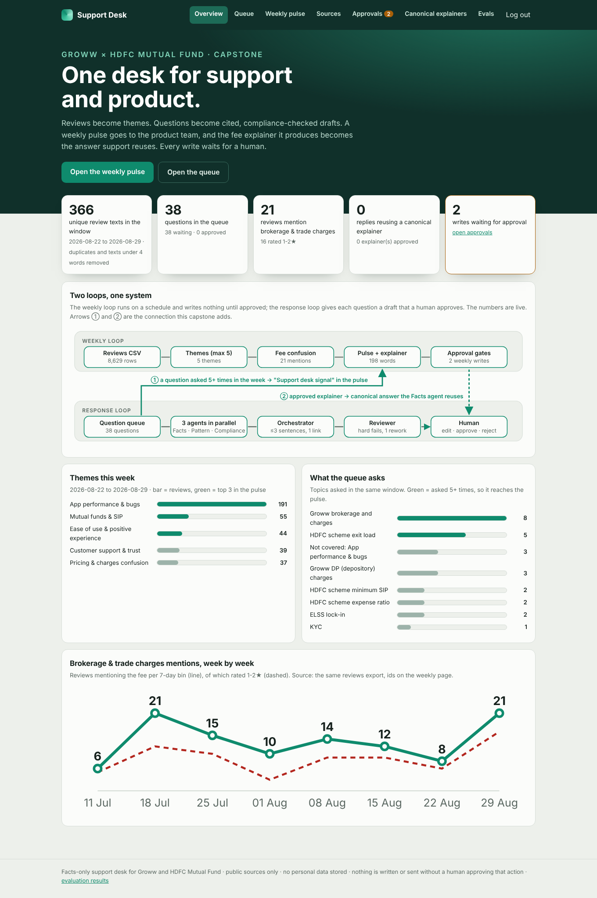
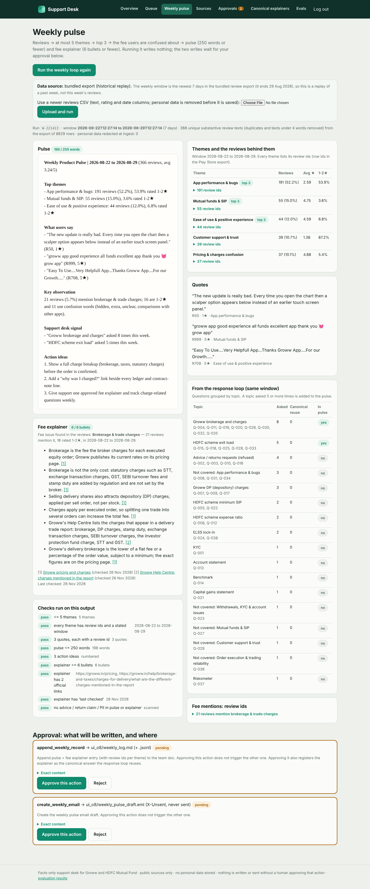
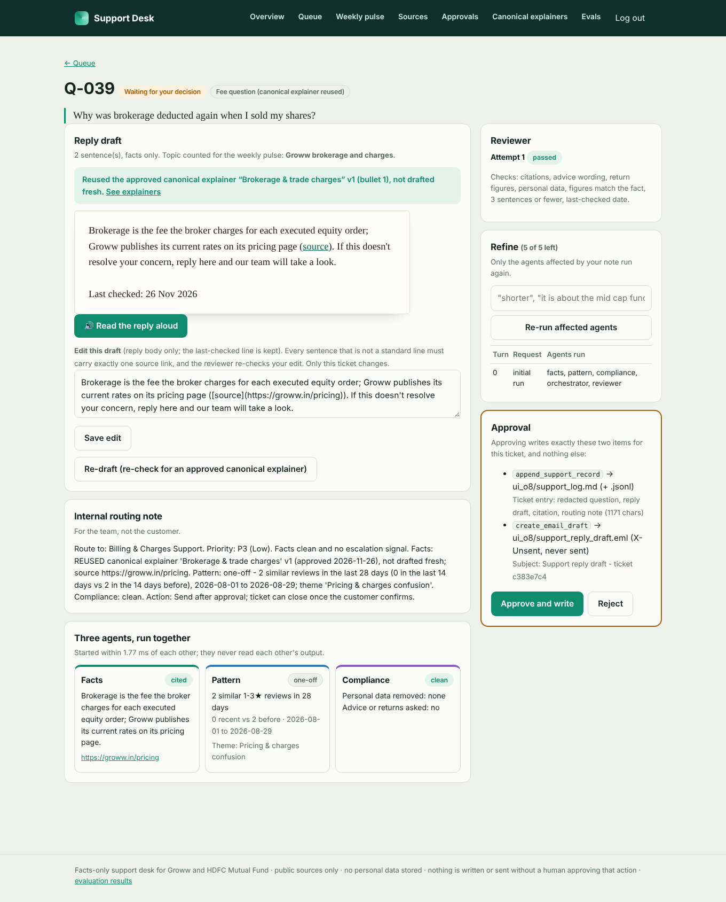
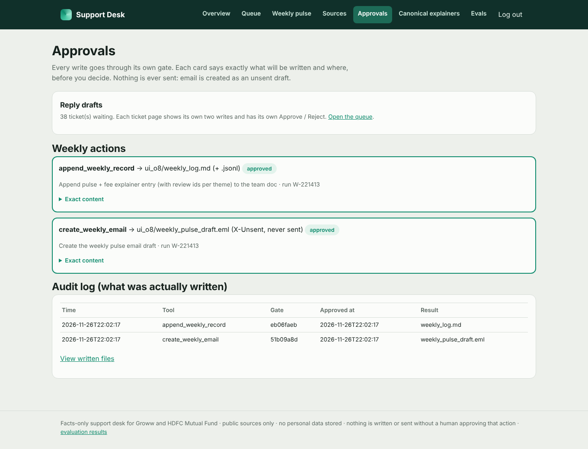

# UI guide and demo script

| Screen | Path | What it shows |
|---|---|---|
| Overview | `/` | KPIs, live two-loop diagram with the two connections, theme and question charts, weekly fee trend |
| Queue | `/queue` | Every question with detected intent, draft, citation and date, reviewer flag, status; add a question (typed or spoken) |
| Ticket | `/ticket/<id>` | Draft as a letter, canonical-reuse banner, routing note, three agents with timings, reviewer attempts, refine, **edit**, re-draft, approval card listing the two writes |
| Weekly pulse | `/weekly` | Pulse (word count), explainer with [1]/[2] markers, themes with expandable review ids and window, quotes with ids, question groups, nine checks, the two approval cards |
| Sources | `/sources` | Every allowed source with last-checked date and how many replies/bullets cite it; each claim in the queue with its link |
| Approvals | `/approvals` | Every action with exact content, status, and the audit log |
| Canonical explainers | `/canonical` | Approved explainers (versioned) and the tickets that reused them |
| Evals | `/evals` | Saved results of the ten evaluation groups (public) |
| Demo | `/demo` | Public, read-only view on synthetic sample data (`make_demo.py`) |
| Written files | `/saved` | What approved actions actually wrote |

## Demo script (5 minutes; the portal asks for a 5 minute video)
Before recording: start the app with `REVIEWER_PASSWORD=demo python app.py` (or use the hosted URL), open it in Chrome or Edge, and have a terminal ready.

| Time | Show | Say |
|---|---|---|
| 0:00 | **Overview** | One desk for support and product. Two loops, two arrows: ① repeated questions go up into the pulse, ② the approved explainer comes down as the canonical answer. Replies are deterministic by design (retrieval, rules, templates), so they cannot invent facts. |
| 0:30 | **Weekly pulse** (log in as reviewer first) | The weekly loop on the newest 7 days, stated as a replay of the bundled export. Max 5 themes, top 3 with review ids, quotes, 3 actions, under 250 words. The fee confusion is brokerage and trade charges: 21 reviews, 16 rated 1–2★. "Groww brokerage and charges asked 8 times" is the signal from the queue. |
| 1:00 | **Fee explainer** | Six bullets, two official links, last-checked date. Expand *Exact content* for the doc action: destination and text are shown before approval. |
| 1:25 | **Approvals: approve one, reject one** | Approve the doc append. The email action is still pending and no email file exists. Reject the email action; show it stays rejected and cannot be approved afterwards. |
| 2:00 | **Connection + three agents** | Queue → type "Why was brokerage deducted again when I sold my shares?" → open the ticket: Facts, Pattern and Compliance ran in parallel, the orchestrator drafted, the reviewer passed, the routing note says *REUSED canonical explainer v1*. Open **Canonical explainers**. |
| 2:40 | **Voice** | Press **Speak** → read the consent notice (browser speech service, no audio stored) → choose Hindi or Kannada if wanted → speak "what is the exit load" → states: listening, processing, heard → the transcript is in the confirm box, not yet submitted → *Use this* → the preview asks which scheme → pick one → Add and run → on the ticket press **Read the reply aloud**. Say honestly that recognition is the browser's. |
| 3:20 | **Compliance refusal** | Add "Should I redeem my HDFC Small Cap Fund units?" → refusal plus only the cited exit-load fact. Then edit a draft to "Groww always charges zero DP fees for sell orders" → the reviewer rejects it, nothing changes. |
| 3:50 | **MCP** | In a terminal: `python -m evals.run_evals` is too long, so run the MCP part: `python tools/mcp_demo.py` (lists the four tools over the protocol, calls one with no receipt (refused), with a receipt (written, unsent draft), replays it (refused)). Then show the audit line `"via": "mcp-server"`. |
| 4:30 | **Evaluation** | Evals page or `python -m evals.run_evals`: all groups green, 177 checks, including approval security, privacy across pathways and the hand-labelled golden dataset. Close by naming the limits: synthetic questions, replayed week, deterministic replies, no real Google Docs or Gmail. |

### Manual microphone check (not done by the author)
Open the app in Chrome or Edge over HTTPS (or `http://localhost`), press Speak, allow the microphone, say "what is the exit load of HDFC Small Cap Fund", and confirm the transcript appears in the confirm box. Repeat once with the permission blocked to see the error message. The automated voice tests use a **mocked** recogniser; they prove the page logic, not the microphone or the speech service.

## Design notes
- Palette: deep green and amber on a warm paper background, dark-mode aware; serif letter style for customer-facing drafts, sans for interface.
- Every status is a labelled pill (never colour alone); inputs have labels; focus outlines are visible; layouts collapse to one column on narrow screens.
- Voice: language selector (English, Hindi, Kannada, Tamil, Telugu), a listening state, plain-language errors (permission denied, no speech, no network), a **transcript confirmation** step (Use this / Speak again / Edit) before anything enters the box, an intent preview as you type (advice will be refused, scheme needed, not covered, personal data will be removed), clarification chips when a scheme-specific question names no scheme, and a **Read the reply aloud** button on each ticket. Checked in a headless browser with a mocked recogniser; a real microphone needs a Chrome/Edge session over HTTPS.
- Access: reviewers log in to the live desk; everyone else sees the public demo (`/demo`, sample data only) with a banner. Record the demo video logged in as the reviewer. The weekly page shows its data source and accepts a newer reviews CSV.
